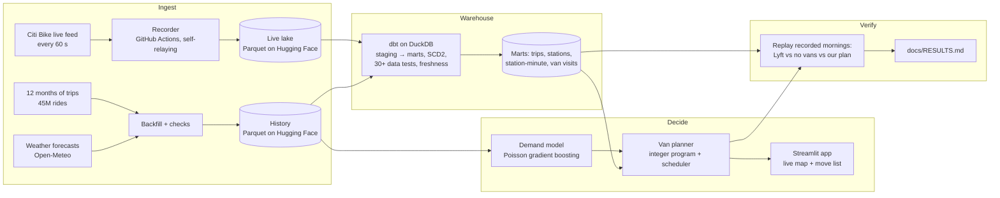

# Citi Bike Rebalancing

Every weekday morning, Citi Bike stations in Midtown fill up so commuters can't dock,
while others run out of bikes. Lyft pays crews to drive vans around and move bikes.
This project records the whole system minute by minute, predicts which stations will
run out or fill up in the next hour, plans van moves to prevent it, and **verifies the
plans against what really happened** on recorded mornings.

**Live app:** https://citibike-van-planner.streamlit.app · **Results:** [docs/RESULTS.md](docs/RESULTS.md)
(updated weekly by a GitHub job)

## How it works



| Part | What it does | Built with |
|---|---|---|
| **Recorder** | Polls the live feed every minute; stores only changes plus a 15-minute heartbeat (~4× less data). Each run starts its successor, because GitHub's scheduler skipped 4 of 7 runs one night. 100% of minutes captured since. | Python, GitHub Actions, Hugging Face Hub; Redpanda (Kafka) + Docker for the local streaming version |
| **History** | 45.4M trips, hourly weather (observed and forecast), holidays. Counts reconcile exactly with Citi Bike's files. | DuckDB, Parquet |
| **Warehouse** | Deduplicated trips with proper time zones; station history (SCD2); bikes at every station every minute; detected Lyft van visits; recorder health. | dbt, DuckDB |
| **Data quality** | 30+ dbt data tests, freshness alerts, known-answer tests on tiny datasets, a daily coverage report, an independent checker on every van plan. | dbt, pytest |
| **Predictions** | Riders taking and returning bikes per station per hour. Beats 12-month averages by 10–13% in the morning rush on a held-out month. Each training run compares versions and keeps the best; a model is only used if it beats the averages. | scikit-learn |
| **Planner** | One pickup and up to 4 drop-offs per trip, van capacity, dock limits and drive times on Manhattan's rotated street grid. Solves Midtown (120+ stations) in under a second. | PuLP / CBC |
| **Verification** | Replays a recorded morning minute by minute under each plan, with hidden demand at empty or full stations. The replay of what actually happened matches the recording exactly. | Python |

## Results so far

On the first fully recorded weekday morning (Tue Oct 20, 8–9am, Midtown, 3 vans), our
plan would have left **18% fewer riders without a bike or a dock** than no vans, while
Lyft's detected van visits that hour made no measurable difference. **One morning is
early evidence, not a verdict**; the weekly job adds every new morning to
[docs/RESULTS.md](docs/RESULTS.md).

## Things that went wrong, and what they taught (details in [docs/PLAN.md](docs/PLAN.md))

- **GitHub's scheduler skipped runs** → an 80-minute gap → runs now hand over to each other.
- **The first demand model was worse than averages** (unstable maths, and a "month"
  feature for a month it never saw) → regularisation, daylight hours, and an approval gate.
- **The planner ignored empty stations**: single-drop trips couldn't justify 5-bike
  deliveries → multi-stop trips.
- **Van-visit detection took three versions** (rush-hour riders, groups of friends,
  Jersey City missing from the data), each found by checking samples by hand.
- **Citi Bike's own data quirks**: month-end rides listed twice, the repeated hour when
  clocks go back, station IDs that look like numbers but aren't.
- **A laptop backfill ran out of memory** → heavy work moved to GitHub, DuckDB capped.

## Limits

- Results so far rest on a few recorded mornings; the claim grows weekly.
- Riders turned away are counted as missed; some would walk to a nearby station.
- Lyft may rebalance in ways the detector can't see (e.g. staff docking extra bikes),
  so "what Lyft did" is likely understated. Final check against October's trips once
  Citi Bike publishes them (mid-November 2026).
- Jersey City and Hoboken are excluded from van detection (their trip files weren't
  downloaded).

## Run it

Everything heavy runs on GitHub; a laptop only sends commands.

```bash
gh workflow run backfill.yml        # past trips, weather, holidays (+ checks)
gh workflow run transform.yml       # dbt warehouse + tests (also every 6 h)
gh workflow run train.yml           # demand model (also weekly)
gh workflow run plan.yml -f at="2026-10-20 08:00"      # plan a recorded morning
gh workflow run backtest.yml -f at="2026-10-20 08:00"  # verify one morning
gh workflow run verify.yml          # verify every recorded morning (also weekly)
gh workflow run coverage.yml        # recorder coverage (also daily)
```

Locally: `make install`, `make test` (105 tests), `make test-dbt`, and
`uv run --extra app streamlit run app/streamlit_app.py` (needs `HF_TOKEN`).
The streaming version runs with `make up` (Redpanda + collector + lake sink in Docker).

- How each step was planned, built and tested: [docs/PLAN.md](docs/PLAN.md)
- Architecture, data contracts and design decisions: [docs/DESIGN.md](docs/DESIGN.md)
- Turning on 24/7 recording for free: [docs/SETUP_CLOUD.md](docs/SETUP_CLOUD.md)
- Putting the app online: [docs/DEPLOY_APP.md](docs/DEPLOY_APP.md)
