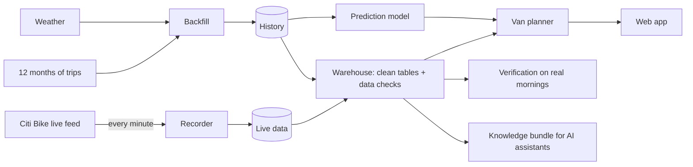

# Citi Bike Rebalancing Platform: User Manual

This manual explains what the platform does, how to set it up from scratch on your own
accounts, how to run it day to day, and what to do when something goes wrong. No
programming is needed for daily use; setup takes about an hour.

**Live app (reference deployment):** https://citibike-van-planner.streamlit.app
**Source code:** https://github.com/rishabhsrinivasan657-design/citibike-rebalancing

---

## Contents

1. [What the platform does](#1-what-the-platform-does)
2. [What runs where](#2-what-runs-where)
3. [Before you start](#3-before-you-start)
4. [Setting up from scratch](#4-setting-up-from-scratch)
5. [Daily operation](#5-daily-operation)
6. [Using the web app](#6-using-the-web-app)
7. [Running analyses on demand](#7-running-analyses-on-demand)
8. [Asking an AI assistant (approved answers)](#8-asking-an-ai-assistant-approved-answers)
9. [Understanding the numbers](#9-understanding-the-numbers)
10. [Maintenance](#10-maintenance)
11. [Troubleshooting](#11-troubleshooting)
12. [Costs and limits](#12-costs-and-limits)
13. [Data, licensing and privacy](#13-data-licensing-and-privacy)
14. [Reference](#14-reference)

---

## 1. What the platform does

Every weekday morning, some Citi Bike stations in New York fill up so commuters can't
park, while others run out of bikes. Lyft moves bikes around in vans to fix this. The
platform:

1. **Records** how many bikes and free docks every station has, every minute, around
   the clock.
2. **Predicts** how many riders will take and return bikes at each station in the next
   hour, from a year of past rides plus the weather forecast.
3. **Plans van moves**: which station to load bikes at, where to drop them, how many,
   and by when, for a chosen area and number of vans.
4. **Verifies** the plans by replaying real recorded mornings: would our plan have
   left fewer riders without a bike or a dock than what actually happened?
5. **Answers questions safely through AI assistants**: an assistant can only get
   numbers from approved, checkable metrics, and is told when data is stale.



---

## 2. What runs where

Nothing needs to run on your own computer. Everything runs on free cloud services:

| Part | Runs on | What you see |
|---|---|---|
| Recorder (every minute) | GitHub Actions | Runs list in GitHub → **Actions → record** |
| Data storage | Hugging Face (two private datasets) | Files on huggingface.co |
| Warehouse, checks, model training, verification | GitHub Actions | Summary pages of each run |
| Web app | Streamlit Community Cloud | Your app's web address |
| AI assistant connection (optional) | Your computer, inside Claude Desktop | Answers in Claude |

**Your two Hugging Face datasets:**

| Dataset | Holds |
|---|---|
| `citibike-station-status` | The live recordings (`lake/`) |
| `citibike-history` | Trips, weather, holidays (`raw/`), clean tables (`marts/`), the prediction model (`models/`), the knowledge bundle (`okf/`) |

---

## 3. Before you start

### Accounts (all free)

| Account | Needed for | Sign up |
|---|---|---|
| GitHub | Code and all automatic jobs | https://github.com/signup |
| Hugging Face | Storing the data | https://huggingface.co/join |
| Streamlit Community Cloud | The web app | https://share.streamlit.io (sign in with GitHub) |
| Anthropic API (optional) | Only the AI agent evaluation in section 7.6 | https://console.anthropic.com |

### Tools on your computer (for setup only)

- **git**: https://git-scm.com/downloads
- **GitHub CLI (`gh`)**: https://cli.github.com, then run `gh auth login` once.
- **uv** (Python tool manager): https://docs.astral.sh/uv/getting-started/installation/
- **Claude Desktop** (optional, for section 8).
- **Docker Desktop** (optional, only for the local streaming demo in section 7.7).

> **Keep heavy work off your laptop.** Downloading and processing a year of trips
> (45 million rides) needs more memory than most laptops spare. Always use the GitHub
> jobs for that, as this manual does.

---

## 4. Setting up from scratch

Allow about an hour. Each step says how to check it worked.

### Step 1: Copy the project to your GitHub account

1. Open https://github.com/rishabhsrinivasan657-design/citibike-rebalancing and click
   **Fork**. Keep it **public**: GitHub only gives unlimited free running time to
   public projects (the recorder alone uses ~2,000 minutes a day). There are no
   passwords in the code.
2. In your fork, open the **Actions** tab and click **I understand my workflows, go
   ahead and enable them**. Forks start with automatic jobs switched off.
3. Copy it to your computer:

   ```bash
   gh repo clone YOUR-GITHUB-NAME/citibike-rebalancing
   cd citibike-rebalancing
   uv sync
   ```

**Check:** `uv run pytest -q` ends with "passed" and no failures.

### Step 2: Create Hugging Face tokens

Make two tokens at huggingface.co → profile picture → **Settings → Access Tokens →
Create new token**:

| Token | Type | Used by |
|---|---|---|
| `github-jobs` | **Write** | GitHub jobs (they save data) |
| `read-only` | **Read** | The web app and the AI assistant (they only read) |

Copy each one when it's shown. Treat tokens like passwords: never paste them into
code, emails or chats.

### Step 3: Give GitHub the token and settings

In the project folder:

```bash
gh secret set HF_TOKEN
```

Paste the **Write** token when asked (the text stays hidden). Then:

```bash
gh variable set HF_REPO --body "citibike-station-status"
```

The datasets are created automatically in your Hugging Face account, and the jobs
work out your username from the token. Optional settings:

| Variable | Default | Change it when |
|---|---|---|
| `HF_HISTORY_REPO` | `citibike-history` | You want a different dataset name |
| `OKF_DATA_URI` | the reference account's dataset | Always set it under your own account: `gh variable set OKF_DATA_URI --body "hf://datasets/YOUR-HF-NAME/citibike-history"` |

**Check:** `gh secret list` shows `HF_TOKEN`; `gh variable list` shows `HF_REPO`.

### Step 4: Start the recorder

```bash
gh workflow run record.yml
```

From then on it runs by itself: each run records for 2 h 45 m and starts the next one
15 minutes before it ends. A schedule every 2 hours is a backup.

**Check:** after ~20 minutes, `citibike-station-status` appears on your Hugging Face
profile with files under `lake/`. GitHub → Actions → **record** shows a run in progress.

### Step 5: Download the history (trips, weather, holidays)

```bash
gh workflow run backfill.yml
```

Takes about 5 minutes. It downloads October 2025 – September 2026 (change with
`-f start=YYYY-MM -f end=YYYY-MM`), checks every month against Citi Bike's files, and
builds each station's typical demand.

**Check:** the run's summary page shows a table of checks, all ✅.

### Step 6: Build the clean tables (warehouse)

Wait at least an hour after Step 4 so there is live data, then:

```bash
gh workflow run transform.yml
```

It builds the tables, runs 31 data checks, checks data freshness, and generates the
knowledge bundle. It then runs by itself every 6 hours.

**Check:** the run is green, and its summary shows a "Warehouse build" table.

### Step 7: Train the prediction model

```bash
gh workflow run train.yml
```

About 20 minutes. It trains two versions, tests both on a month they never saw, and
keeps the better one, but **only if it beats plain averages**. Otherwise the planner
simply uses averages. Retrains every Monday by itself.

**Check:** the summary ends with "**Chosen: v2**" (or v1) and "approved".

### Step 8: Put the web app online

1. Go to https://share.streamlit.io, sign in with GitHub, click **Create app →
   Deploy a public app from GitHub**.
2. Repository: `YOUR-GITHUB-NAME/citibike-rebalancing`; branch `main`; main file
   path `app/streamlit_app.py`.
3. **Advanced settings**: Python **3.12**; Secrets:

   ```
   HF_TOKEN = "your read-only token"
   ```

4. Click **Deploy**. The first start takes 3–5 minutes.

**Check:** the app shows four numbers, a map and a van-moves table. More detail:
[DEPLOY_APP.md](DEPLOY_APP.md).

### Step 9 (optional): Connect Claude Desktop

See section 8.

### You're done when…

- [ ] Actions → **record** shows a run in progress
- [ ] Hugging Face has both datasets
- [ ] **transform** and **train** runs are green
- [ ] The web app shows a map and a plan

---

## 5. Daily operation

Everything below runs by itself. Times are New York time (EDT; one hour earlier in
winter).

| Job | When | What it does | Where results go |
|---|---|---|---|
| **record** | Continuously | Records every station every minute | Hugging Face `lake/` |
| **transform** | Every 6 hours (about 2:45am, 8:45am, 2:45pm, 8:45pm) | Clean tables, data checks, freshness, knowledge bundle | Hugging Face `marts/`, `okf/`; run summary |
| **coverage** | Daily 9:40am | Share of minutes recorded in the last 24 h (target 98%) | Run summary |
| **train** | Mondays 3:30am | Retrains and re-tests the prediction model | Hugging Face `models/`; run summary |
| **verify** | Tuesdays 10am | Replays every fully recorded weekday morning | `docs/RESULTS.md` in the repository |
| **pitfalls** | Tuesdays 10:30am | Trap analysis (section 7.5) | `okf/PITFALLS.md` in the repository |
| **ci** | Every code change | Runs all automatic tests | Actions → ci |

### What to check, and how often

- **Normally: nothing.** GitHub emails the repository owner when a scheduled job fails.
- **Weekly (2 minutes):** open `docs/RESULTS.md` on GitHub to see the latest
  verification table.
- **If you get a failure email:** see section 11.

### Alerts that matter

| Alert | Meaning | Urgency |
|---|---|---|
| **coverage** failed | Under 98% of minutes recorded in the last day | Check the recorder today |
| **transform** failed at "Fail if live data was stale" | No new live data for over an hour | Check the recorder now |
| **transform** failed at "Build tables" | A data check failed: the data changed in an unexpected way | Look at the run log; don't trust new numbers until fixed |
| **train** says "not approved" | The new model didn't beat averages | No action needed; the app keeps working on averages or the previous model |

---

## 6. Using the web app

Open your app's address. If nobody has used it for a few days, it takes about 30
seconds to wake up.

**Sidebar (on a phone, tap ">" at the top left):**

| Control | What it does |
|---|---|
| Area | Midtown, Downtown, Union Square or Williamsburg |
| Vans | Crew size, 1–6 vans |
| Plan ahead | 30, 60 or 90 minutes |
| Use the prediction model | On: predictions with the live weather forecast. Off: 12-month averages. |
| Refresh now | Fetch the newest bike counts (they also refresh every minute) |

**Top numbers:** riders expected to **miss out** (no bike or no free dock) with no vans,
the same with the plan, bikes moved, and van trips.

**Map:** 🔴 will run out of bikes · 🟠 will fill up · 🟢 fine for the hour. Curved lines
are van moves, from blue (pick up) to green (drop off). Hover or tap for details.

**Van moves table:** the crew's list. Each trip loads once and can drop off at up to 4
stations; rows with the same van and trip number belong to one trip.

**Best times to look:** weekdays 7:30–9:30am and 5–7pm, when the system is busiest.

---

## 7. Running analyses on demand

All of these run on GitHub; results appear on the run's summary page (Actions → the job
→ the latest run), or as files in the repository where noted.

### 7.1 Plan a specific morning

```bash
gh workflow run plan.yml -f at="2026-10-20 08:00"            # a recorded morning
gh workflow run plan.yml -f start=08:00 -f vans=3            # typical weekday, live counts
gh workflow run plan.yml -f at="2026-10-20 08:00" -f zone=downtown -f vans=4
```

### 7.2 Verify the plan on one recorded morning

```bash
gh workflow run backtest.yml -f at="2026-10-20 08:00"
```

Compares, for that hour and area: what actually happened (Lyft's vans), no vans at
all, and our plan made with averages and with predictions. The first check line must
say the replay differs from the recording by **0 bikes**; otherwise don't trust the
comparison.

### 7.3 Verify on every recorded morning

```bash
gh workflow run verify.yml
```

Updates `docs/RESULTS.md`. Fewer than 10 mornings is early evidence, not a verdict; the
file says so.

### 7.4 Check recording coverage

```bash
gh workflow run coverage.yml -f hours=24
```

### 7.5 Trap analysis (how much the definitions matter)

```bash
gh workflow run pitfalls.yml
```

Updates `okf/PITFALLS.md`. For each question, it compares the correct answer with the
answer you'd get from a common mistake (UTC dates instead of New York dates, counting
closed stations as empty, a naive van rule, and so on). No AI is involved.

### 7.6 AI agent evaluation (optional, costs money)

Measures whether an AI agent answers correctly with the knowledge bundle versus with
raw tables only. Needs an Anthropic API key:

```bash
gh secret set ANTHROPIC_API_KEY
gh workflow run eval.yml                                  # Claude Opus 5.5
gh workflow run eval.yml -f model=claude-sonnet-5-5       # cheaper
```

Estimated cost: roughly $5–10 per run on Opus 5.5, less on cheaper models (an
estimate, not measured). Results go to `okf/EVAL.md`.

### 7.7 Local streaming demo (optional)

Runs the original Kafka-based recorder on your computer with Docker, for
demonstrations only (it isn't needed for operation):

```bash
make up      # start Redpanda (Kafka), the collector and the lake writer
make logs    # watch it work; a line per minute with ok=True
make down    # stop it
```

---

## 8. Asking an AI assistant (approved answers)

The platform publishes a **knowledge bundle** in Google's open OKF format: what every
table and column means, how tables join, known data quirks, and **approved metrics**.
An AI assistant connected to it can only get numbers by running an approved metric;
each answer comes with a receipt that a separate checker verifies, plus warnings when
data is stale or a definition hasn't been reviewed by a person.

### Connect Claude Desktop

1. In the project folder: `uv sync --extra agent`
2. Claude Desktop → **Settings → Developer → Edit Config**, add (with your path and
   **read-only** token):

   ```json
   {
     "mcpServers": {
       "citibike": {
         "command": "/FULL/PATH/TO/citibike-rebalancing/.venv/bin/okf-mcp",
         "env": { "HF_TOKEN": "hf_your_read_only_token" }
       }
     }
   }
   ```

3. Restart Claude Desktop. It downloads a few MB on first use.

**Try:** "Which Midtown stations were empty the longest yesterday?" · "How many van
drop-offs were there system-wide on October 20?" · "How many riders were turned away?"
(no approved metric exists for that, so it should say it can't answer reliably).

### Approved metrics

| Metric | Answers |
|---|---|
| Stations empty longest | Which stations had no bikes for the most minutes, by day and area |
| Stations full longest | Which stations had no free docks for the most minutes |
| Van activity | Likely Lyft van drop-offs, pickups and bikes moved per day |
| Recorder coverage | Share of minutes recorded per day |
| Busiest stations | Most rides started plus ended, by month and area |

### Marking content as reviewed

Every concept starts as **unverified** (or **machine-confirmed** when all its data
checks passed). When a person has read a concept and checked it against the data, add
it to `okf/verified.yml`:

```yaml
tables/agg_station_day:
  - { by: "human:your-name", at: "2026-10-22T15:00:00Z" }
```

Commit the change. The next warehouse build marks it **human-reviewed**, and assistants
stop warning that it's unverified.

---

## 9. Understanding the numbers

| Term | Meaning |
|---|---|
| **Empty minutes** | Minutes a station had no bike to rent while it was open, counted only while the recorder was running |
| **Full minutes** | Minutes a station had no free dock while accepting returns |
| **Riders who'd miss out** | Riders estimated to find no bike or no dock. Includes riders who wanted a bike at an empty station and left no record (**hidden demand**, estimated from usual demand). Some would walk to a nearby station, so this overstates real misses |
| **Van visit** | A sudden jump in bikes too large for riders at that station and hour; **inferred**, not reported by Lyft. Jersey City and Hoboken are not covered |
| **Coverage** | Share of minutes the recorder captured; target 98% |
| **Prediction error** | Average miss in riders per station per hour. The model beats 12-month averages by about 10–13% in the morning rush on a month it never saw |

**How much to trust results:** the replay of recorded mornings reproduces reality
exactly; the comparison between plans rests on stated assumptions (in `docs/PLAN.md`,
Step 6). Results from fewer than 10 mornings are early evidence. Lyft may rebalance in
ways the detector can't see, so "what Lyft did" is probably understated.

---

## 10. Maintenance

| Task | When | How |
|---|---|---|
| Add a newly published month of trips | Monthly (Citi Bike publishes ~2–3 weeks after the month ends) | `gh workflow run backfill.yml -f start=2025-10 -f end=YYYY-MM`, then `transform.yml` and `train.yml` |
| Add or change a zone | When needed | Edit `transform/seeds/zones.csv` **and** `ZONES` in `src/rebalancer/planner/run.py` (both, same name, centre and radius); commit; run `transform.yml` |
| Tune the van-visit rule | Rarely | `transform/models/marts/fct_inferred_rebalancing.sql` (settings at the top); check 10 samples by hand on the transform summary page |
| Update software versions | Every few months | `uv lock --upgrade`, run `uv run pytest -q`; if the app's scikit-learn version changes, update `app/requirements.txt` to match and retrain |
| Restart the app | If it shows errors | Streamlit → your app → ⋮ → **Reboot app** |
| Keep the schedule alive | Automatic | The weekly verify and pitfalls jobs commit to the repository, which stops GitHub pausing schedules after 60 quiet days |

---

## 11. Troubleshooting

| Symptom | Likely cause | Fix |
|---|---|---|
| **record** runs fail with "HF_REPO and HF_TOKEN must be set" | Step 3 incomplete | `gh secret set HF_TOKEN`; `gh variable set HF_REPO --body "citibike-station-status"` |
| Error says the token is **read-only** | A Read token was used for GitHub | Make a **Write** token; `gh secret set HF_TOKEN` again |
| Error says "token belongs to …" | `HF_REPO` names another account | Set `HF_REPO` to just `citibike-station-status` |
| Coverage below 98% / gaps | GitHub skipped or delayed runs | Check Actions → record. If nothing is running: `gh workflow run record.yml` |
| Scheduled jobs stopped running | GitHub paused them after 60 days without activity, or Actions was disabled | Actions → the job → **Enable workflow**; then run it once |
| **transform** fails "stale" | The recorder stopped | Fix the recorder; the tables were still saved |
| **train** "not approved" | New model no better than averages | Nothing to do; investigate only if it persists for weeks |
| App: "needs an HF_TOKEN secret" | Secret missing in Streamlit | App → ⋮ → Settings → Secrets: `HF_TOKEN = "..."` |
| App: "Couldn't build a plan right now" | Citi Bike feed or Hugging Face briefly unavailable | Wait a minute, click **Refresh now** |
| App very slow at first | It was asleep | Normal; about 30 seconds |
| Claude Desktop shows no "citibike" tools | Wrong path in config, or `uv sync --extra agent` not run | Check the `command` path exists; restart Claude Desktop |
| Your laptop slows down while running something | A heavy job ran locally | Stop it; run the equivalent GitHub job instead |

**Getting the details of a failure:** GitHub → Actions → the failed run → click the
red step. Or from a terminal: `gh run list --limit 5` to find the run's ID, then
`gh run view RUN-ID --log-failed`.

---

## 12. Costs and limits

| Service | Cost | Limit to know |
|---|---|---|
| GitHub Actions | Free for public repositories | Scheduled runs can start late or be skipped; the recorder relays to cover this |
| Hugging Face | Free | Datasets are private by default; storage grows by a few MB a day (estimate) |
| Streamlit Community Cloud | Free | App sleeps when unused; small server (plans take ~3 s) |
| Anthropic API | Pay as you go | Only for the optional agent evaluation |
| Citi Bike data | Free | Subject to Citi Bike's data license (section 13) |

---

## 13. Data, licensing and privacy

- **Sources:** Citi Bike's public live feed (GBFS) and monthly trip files, Open-Meteo
  weather (free for non-commercial use), and public holiday calendars.
- **Licensing:** Citi Bike data is provided under its own data license agreement
  (https://citibikenyc.com/data-sharing-policy). Read it before publishing data or using
  the platform commercially. Open-Meteo's terms differ for commercial use.
- **Privacy:** trip files contain no names or personal identifiers, and the platform
  adds none. Datasets are private by default; make them public only after checking the
  licenses.
- **Credentials:** tokens live only in GitHub secrets, Streamlit secrets and your
  Claude Desktop config, never in the code.

---

## 14. Reference

### GitHub jobs

| Job | Starts | Manual command | Settings it needs |
|---|---|---|---|
| record | Continuously (self-relaying) | `gh workflow run record.yml` | `HF_TOKEN`, `HF_REPO` |
| backfill | On demand | `gh workflow run backfill.yml [-f start=… -f end=…]` | `HF_TOKEN` |
| transform | Every 6 h | `gh workflow run transform.yml` | `HF_TOKEN`, `HF_REPO` |
| coverage | Daily | `gh workflow run coverage.yml -f hours=24` | `HF_TOKEN`, `HF_REPO` |
| train | Mondays | `gh workflow run train.yml` | `HF_TOKEN` |
| plan | On demand | `gh workflow run plan.yml -f at="YYYY-MM-DD HH:MM"` | `HF_TOKEN` |
| backtest | On demand | `gh workflow run backtest.yml -f at="YYYY-MM-DD HH:MM"` | `HF_TOKEN` |
| verify | Tuesdays | `gh workflow run verify.yml` | `HF_TOKEN` |
| pitfalls | Tuesdays | `gh workflow run pitfalls.yml` | `HF_TOKEN` |
| eval | On demand | `gh workflow run eval.yml [-f model=…]` | `HF_TOKEN`, `ANTHROPIC_API_KEY` |
| app-check | On demand | `gh workflow run app-check.yml` | `HF_TOKEN` |
| ci | Every push | automatic | none |

### Commands (from the project folder, `uv run <command>`)

| Command | Purpose |
|---|---|
| `okf-mcp` | AI assistant server (Claude Desktop starts it for you) |
| `okf-sync` | Download the knowledge bundle and small tables |
| `okf-metric list` / `okf-metric run …` | List or run an approved metric, with its receipt |
| `okf-validate <folder>` | Check a knowledge bundle against the OKF spec |
| `pytest -q` | Run the automatic tests |

Other commands (`recorder`, `backfill`, `warehouse`, `forecast-train`, `plan-moves`,
`backtest`, `okf-generate`, `okf-eval`, `okf-pitfalls`) are what the GitHub jobs run;
you shouldn't need them directly.

### Project map

| Folder / file | Contents |
|---|---|
| `app/` | The web app |
| `src/rebalancer/` | All the code (recorder, backfill, planner, prediction, verification, knowledge layer) |
| `transform/` | Warehouse definitions (dbt), data checks, zones |
| `okf/static/` | Hand-written knowledge (glossary, approved metrics); `okf/verified.yml` (human reviews) |
| `.github/workflows/` | The automatic jobs |
| `docs/PLAN.md` | How every part was planned, built and tested, with results and known limits |
| `docs/DESIGN.md` | Technical design and decisions |
| `docs/RESULTS.md`, `okf/PITFALLS.md` | Latest verification and trap analysis (updated weekly) |
| `docs/DEPLOY_APP.md`, `docs/AGENT.md`, `docs/SETUP_CLOUD.md` | Focused setup guides |

### Settings

| Name | Kind | Where | Required |
|---|---|---|---|
| `HF_TOKEN` (Write) | Secret | GitHub | Yes |
| `HF_REPO` | Variable | GitHub | Yes (`citibike-station-status`) |
| `HF_HISTORY_REPO` | Variable | GitHub | No (default `citibike-history`) |
| `OKF_DATA_URI` | Variable | GitHub | Recommended under your own account |
| `ANTHROPIC_API_KEY` | Secret | GitHub | Only for the agent evaluation |
| `HF_TOKEN` (Read) | Secret | Streamlit, Claude Desktop config | Yes, for those |
